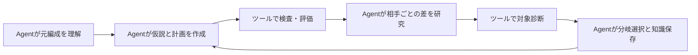

# gekitotsu_lab

Lab **0.6.5**、内蔵GekitotsuKit **1.9.1**。バージョンは個別に管理します。

**軽量なツールキットから、大規模言語モデルの実験室へ。**

激突Labは激突Kitのツール基盤を受け継ぎ、大規模言語モデルのAgentが編成を研究し、戦術仮説を検証し、検証可能な結果と再利用できる知識を蓄積するための実験環境です。

**Agentが編成を理解し、対照実験を設計・実行し、実際の対戦から学んで証拠付きの改善を届けるための環境。**

このプロジェクトは激突KitにAgentの作業規約、編成知識、実行ツール、実験状態を統合します。ローカルファイルとコマンドを扱えるAgentがルールと機構を読み、元編成を調べ、検証可能な変更を提案し、具体的な対戦の利益と損失から次の方向を選びます。

[English](README.md) | [简体中文](README.zh-CN.md) | 日本語

## Agentの能力

| 能力 | Agentの役割 |
|---|---|
| 編成の理解 | 実際のID・スロットを読み、ユニットと戦術知識から火力、支持、防護・迎撃、回復、加速、突撃タイミングを理解 |
| 元編成の研究 | 200/2000/10433の完全基準評価を実行または検証して再利用。相手群と代表的な勝敗を調べ、探索前に勝ち筋と失敗経路を記録 |
| 対照実験の設計 | 観察を仮説・親編成・制約付きJSON計画・対象相手・失敗条件に変換し、単独変更と組み合わせ、合法な反実仮想を区別 |
| 研究の実行と管理 | 候補生成、ルール・重力検査、実時間制限付きバックグラウンド評価、検証済み結果の再利用、実計算量と再開状態を管理 |
| 個別対戦からの学習 | 実際の親との改善・悪化を比較し、少数の詳細再生で重要な説明を検証。別分岐、同点候補、反例を保持して次を選択 |
| 選抜と成果物 | 学習・競合検証の結果で親と決勝候補を選び、完全対戦集の成績・取捨選択・正確なコード・合法性・証拠を提示 |
| 再開と知識保持 | STATEと固定入力から再開し、停止状態とユーザー選択を尊重。LEARNINGを更新し、結果はローカル保存、公開可能な汎用知識だけをコミット |

能力は[AGENTS.md](AGENTS.md)、[研究手順](docs/ai/formation-tuning.md)、[知識庫](docs/ai/knowledge/README.md)に定義します。推論と判断はAgentが担当し、次のツールが実行・測定・検証を支えます。

## Agentを支えるツール

| ツール群 | 支援内容 |
|---|---|
| 生成・重力検査 | 座標・角度・構成計画、ルール検査、安定配置への変換、重複排除、出典対応 |
| 一括評価・検証 | 物理側固定、不足分のバッチ処理、検証済みキャッシュ、STOP、対戦ごとの検証 |
| 基本・詳細観測 | 生存、回復、発進・着地、攻撃、HP変化、迎撃、弾丸・爆発の生成元 |
| 証拠と限定照会 | 完全JSON、SQLite索引、ハッシュ、項目投影、ユニット・時間指定、ページング |
| Kit共有分析 | 図鑑、ワークベンチ、軌道、寄与、相性、戦場分析のCLI/JSONアクセスとGUI共有モデル |

対戦GUI、ワークベンチ、軌道編集、図鑑、プラグインも利用できます。操作は[ユーザーマニュアル](使用手册.md)を参照してください。

## クイックスタート

### Agentを開始する

ローカルファイルとコマンドを扱えるAgent環境で現在のディレクトリを開き、[AGENTS.md](AGENTS.md)と[文書ガイド](docs/ai/README.md)を読ませてください。元編成、制約、目標、計算予算を指定します。再利用可能な依頼は[PROMPTS](docs/ai/PROMPTS.md)にあります。

```text
AGENTS.mdとdocs/ai/README.mdを読む。
元編成：<パス>。ルール・許可変更：<制約>。
目標・物理側：<目標>。対戦予算：<上限>。
現行研究手順に従い、検証済み証拠を再利用してSTATEを保存する。
```

### プレイヤーとAgentで編成を磨く

プレイヤーも継続して編成改善に参加し、研究の方向を確認し、戦術の案を出し、各実験の発見をAgentと話し合うことを勧めます。実戦経験とAgentの一括実験を組み合わせることで、見落とした方向や誤解に気づき、自分の目標に沿った改善につなげられます。

- **残したいものを伝える。** 編成の特徴、必須ユニット、変更可能な範囲、重視する相手や取捨選択を指定します。
- **経験を検証可能な案にする。** 気づいた弱点や組み合わせを伝え、Agentに機構の説明と小規模な対照実験を依頼してから探索を広げます。
- **過程と証拠を確認する。** 代表的な勝敗や相手ごとの改善・悪化を見て、何が効き、何を失ったのかを確認します。説明が実戦と合わなければ指摘してください。
- **結果を踏まえて対話を続ける。** 続ける分岐、打ち切る分岐、新しい方向を相談し、必要なら予算の調整や停止を選びます。戦術案は仮説として扱い、実際の対戦で検証します。

例：「前衛が早く倒れ、後衛の攻撃が途切れている気がします。コアと主力は残し、支持位置と防護配置を対照実験してください。救えた敗戦と新たに生じた敗戦を報告してから、次の方向を一緒に決めたいです。」

### ツールの準備

現在の手順はWindowsとPowerShellを対象とします。JDK 21+、Maven 3.9+、Rust 2024 edition対応ツールチェーンとMSVCリンクツール、`opencode`というconda環境を準備してください。Pythonコマンドは標準ライブラリのみを使用します。

プロジェクトルートで実行します：

```powershell
conda activate opencode
$env:PYTHONIOENCODING = 'utf-8'
./tools/ai/build.ps1
python tools/ai/gravity.py build --timeout 300
```

build.ps1は研究用JARと基本・詳細観測器を構築します。重力検査器は独立したビルドと出力先を使用します。依存関係の取得は[環境・ネットワーク設定](docs/ai/03-tool-runbook.md#环境准备)を参照してください。Cargoの取得にはHTTP_PROXY/HTTPS_PROXYで明示的にプロキシを設定でき、依存関係がキャッシュ済みならbuild.ps1 -Offlineを使用できます。

対戦せずに機能・バックエンド・例示編成を確認します：

```powershell
conda activate opencode
python tools/ai/ai.py --timeout 30 capabilities
python tools/ai/ai.py --timeout 30 probe
python tools/ai/ai.py --timeout 30 formation --file docs/ai/examples/candidate.txt
```

ソースから構築したGUIの起動：

```powershell
java -jar target/gekitotsu_lab-0.6.5.jar
```

CLI/JSONの使い方は[ツール手順](docs/ai/03-tool-runbook.md)と[機能一覧](docs/ai/capabilities.md)を参照してください。ローカル配布版の激突Kit.exeも利用できますが、配布バイナリとソースビルドは別のバージョンとして扱います。

## 編成研究の流れ



元編成を理解し、完全な基準評価を実行または検証して再利用します。その後、対照付きの小バッチで探索し、対戦相手ごとの改善・悪化と必要な診断を調べて次の親編成・パラメータを選びます。

対戦集は**200編成が学習・選別、2000編成が競合候補の検証、10433編成が固定した決勝候補の比較**に対応します。フレーム上限は引き分けとして採点し、欠落やプロセスエラーは別に失敗として扱います。対戦集の版・選抜・採点は[評価方針](docs/ai/10-benchmark-usage.md)で定義します。

実行経路は`formation_workflow generate/accept` → `gravity.py evaluate` → `verify_pool.py`です。[研究手順](docs/ai/formation-tuning.md)、[生成器](docs/ai/generator.md)、[重力検査](docs/ai/gravity-audit.md)に計画・コマンド・適用範囲をまとめています。

## 知識の調べ方

[文書ガイド](docs/ai/README.md)が問題別の入口です。[基礎機構](docs/ai/08-formation-fundamentals.md)と[ユニット百科](docs/ai/knowledge/units/README.md)は支持・カウンタ・更新順序・各ユニットと生成物を説明します。[戦術知識](docs/ai/knowledge/tactics/README.md)は勝ち筋と組み合わせ、[攻撃タイミング](docs/ai/13-volley-timing.md)は発射位相と実際の命中の違いを扱います。

[分析の解釈](docs/ai/knowledge/analysis-usage.md)はヒートマップ・削除寄与・ダメージ出典の意味を、[探索の知見](docs/ai/11-search-lessons.md)は条件比較・同点領域・探索境界を説明します。[データ契約](docs/ai/data-contract.md)と[詳細モード](docs/ai/detailed-mode.md)は項目とイベントを定義し、[実験記録](docs/ai/05-experiment-contract.md)は再現と引き継ぎを扱います。

## コード構成

| パス | 用途 |
|---|---|
| [AGENTS.md](AGENTS.md) | Agent規約、読書経路、制約、引き継ぎ |
| `src/main/java/` | Kit GUI、共有分析モデル、Java --ai入口 |
| `tools/ai/` | 候補生成、重力、評価、観測、照会、検証 |
| `rust/observer/` | 独立したgkt-observe / gkt-detail |
| `rust/gravity/` | 独立ビルドの静的重力・支持検査 |
| `rust/vendor/` | 固定されたコアソース、出典、ハッシュ |
| `benchmarks/` | 固定対戦集と識別マニフェスト |
| `docs/ai/` | 手順、契約、機構、戦術、研究方法 |
| `experiments/` | 実行時に作成するローカル研究データ。Git管理・配布対象外 |

## エンジンの版と証拠

高速評価は選択したJAR内のJNI DLLを使用し、ソース観測器は固定Rustコアの派生版を使用します。現行ソースのcatalog-hp-v1は青加速器HP100、電梯壁HP75ですが、元配布DLLは以前のルールを保持します。ソースの再ビルドはそのDLLを置き換えません。比較・再生前に[HPルール](docs/ai/unit-hp-rules.md)と[エンジン適用範囲](docs/ai/01-project-map.md#引擎核验与证据范围)を確認してください。

編成コード、物理側、フレーム上限、seed方針、エンジン・アダプタのハッシュが証拠の識別条件です。診断は対応する評価と結果が一致してから説明に使用します。静的検査が保証するのは宣言されたモデルと側であり、シミュレータ結果は元Flash版との同等性を保証しません。

## 作者とライセンス

[gekitotsu_java](https://github.com/xx786029704-arch/gekitotsu_java)を基盤とし、[gekitotsu_rust](https://github.com/xx786029704-arch/gekitotsu_rust)のコアソースを利用しています。

制作者：**XX、DeepSeek、15222HGH、MKTL、GPT-6.1 Sol、Nightvision65**。

非公式ファンプロジェクトです。ゲーム素材は原著作者に帰属し、プロジェクトコードは[MITライセンス](LICENSE)で公開されています。

[Release build and package contents](docs/releasing.md) · [Third-party notices](THIRD_PARTY_NOTICES.md)
