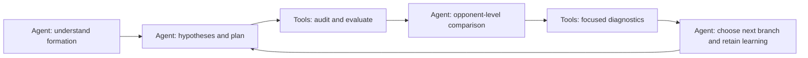

# gekitotsu_lab

Lab **0.6.6**, using GekitotsuKit **1.9.1**. Their versions are maintained independently.

**From a lightweight toolkit to a large language model laboratory.**

激突Lab builds on GekitotsuKit, carrying its toolkit foundations into a laboratory for LLM agents to study formations, test tactical hypotheses, and retain verifiable results and reusable knowledge.

**Give an agent the knowledge, tools, and evidence to understand a formation, run controlled experiments, and improve it.**

This project combines GekitotsuKit with an agent operating contract, formation knowledge, executable research tools, and persistent experiment state. An agent with local file and shell access reads the rules and mechanics, studies the starting formation, proposes testable changes, runs evaluations, and uses actual gains and regressions to choose the next step.

English | [简体中文](README.zh-CN.md) | [日本語](README.ja.md)

## Agent capabilities

| Capability | How the agent works |
|---|---|
| Understand the formation | Decode actual unit IDs and slots, read the relevant unit and tactical knowledge, and reason about firepower, support, interception, recovery, acceleration, and assault timing. |
| Research the starting point | Complete or verify the original formation's 200/2000/10433 baselines, study opponent groups and representative wins/losses, and record a baseline explanation before generating search candidates. |
| Design controlled experiments | Turn observations into hypotheses, explicit parent formations, constrained JSON plans, expected beneficiaries, and failure criteria. Separate single changes from joint effects and preserve valid counterfactuals. |
| Execute and manage research | Generate candidates, enforce rules and gravity checks, run bounded background evaluations, reuse verified games, track real simulation cost, and preserve progress for safe continuation. |
| Learn from opponent-level changes | Compare each candidate with its actual parent, identify improved and worsened matchups, test key explanations with selected detailed replays, and retain useful alternatives and counterexamples. |
| Select and deliver with evidence | Use training and competitive validation feedback to choose branches and finalists. Report complete pool results and tradeoffs, exact formation codes, legality, and verifiable evidence. |
| Resume and retain knowledge | Recover from STATE and frozen inputs, respect stopped tasks and user choices, maintain LEARNING, archive results locally, and commit reusable public knowledge. |

These capabilities are defined by [AGENTS.md](AGENTS.md), the [research workflow](docs/ai/formation-tuning.md), and the [knowledge library](docs/ai/knowledge/README.md). The agent supplies the reasoning and decisions; the following tools make its actions measurable and reproducible.

## Tools supporting the agent

| Tool group | Support provided |
|---|---|
| Generation and gravity | Parameterized coordinate/angle/structure plans, rule checks, stable-layout conversion, deduplication, and source mappings |
| Batch evaluation and verification | Fixed-side pool evaluation, missing-game batching, verified cache reuse, STOP, and per-opponent result verification |
| Basic and detailed observation | Lifecycle, recovery, launch/landing, attacks, HP writes, interception, and projectile/explosion source chains |
| Evidence and bounded queries | Full JSON artifacts, SQLite indexing, hashes, field projection, unit/frame filters, and paginated output |
| Shared Kit analysis | CLI/JSON access to catalog, workbench, trajectories, contribution, matchup, and battlefield analysis, with shared GUI models |

The battle GUI, workbench, trajectory editor, unit dex, and effect plugins remain available. See the [user manual](使用手册.md) for their operation.

## Quick start

### Start with an agent

Open this checkout in an agent environment with local file and command access. Have it read [AGENTS.md](AGENTS.md) and the [documentation guide](docs/ai/README.md), then give it the source formation, constraints, goal, and computation budget. Reusable tasks are in [PROMPTS](docs/ai/PROMPTS.md).

```text
Read AGENTS.md and docs/ai/README.md.
Starting formation: <path>. Rules and allowed changes: <constraints>.
Goal and candidate side: <goal>. Simulation budget: <limit>.
Follow the current research workflow; reuse verified evidence and preserve STATE.
```

### Improve formations together with the agent

Players are encouraged to stay involved: supervise the research direction, suggest tactical ideas, and discuss each round's findings with the agent. Player experience and the agent's batch experiments can complement each other, uncover missed directions, correct misunderstandings, and keep improvements aligned with your goals.

- **Explain what matters to you.** Specify the formation's identity, units to retain, allowed changes, and the opponents and tradeoffs you care about.
- **Turn experience into testable ideas.** Share weaknesses or combinations you have noticed. Ask the agent to explain the mechanism and run a small controlled comparison before expanding the search.
- **Review the process and evidence.** Examine representative wins/losses and opponent-level gains and regressions. Ask where an improvement comes from and what it costs; flag explanations that conflict with actual play.
- **Use results to guide the next discussion.** Decide together which branches to keep, drop, or explore, and adjust the budget or stop when needed. Treat tactical suggestions as hypotheses to verify in actual battles.

For example: “I suspect the front line collapses too early and interrupts the rear units' attacks. Keep the core and main attackers, compare support positions and protection setups, and report which losses become wins and which new losses appear before we choose the next step.”

### Prepare the tools

The maintained workflow uses Windows and PowerShell. Prepare JDK 21+, Maven 3.9+, a Rust toolchain supporting edition 2024 with MSVC linking tools, and a conda environment named `opencode`. The Python command tools use the standard library.

From the repository root:

```powershell
conda activate opencode
$env:PYTHONIOENCODING = 'utf-8'
./tools/ai/build.ps1
python tools/ai/gravity.py build --timeout 300
```

`build.ps1` builds the research JAR and both battle observers. The gravity checker has its own build and target directory. Dependency downloads follow the [environment and network setup](docs/ai/03-tool-runbook.md#环境准备); the build script honors explicitly configured HTTP_PROXY/HTTPS_PROXY for Cargo downloads. With all dependencies cached, use `build.ps1 -Offline`.

Inspect the interface and an example formation without running a battle:

```powershell
conda activate opencode
python tools/ai/ai.py --timeout 30 capabilities
python tools/ai/ai.py --timeout 30 probe
python tools/ai/ai.py --timeout 30 formation --file docs/ai/examples/candidate.txt
```

The source GUI starts with:

```powershell
java -jar target/gekitotsu_lab-0.6.6.jar
```

For CLI/JSON usage, see the [tool runbook](docs/ai/03-tool-runbook.md) and [capability map](docs/ai/capabilities.md). The Windows portable release starts with `gekitotsu_lab.exe`; its GUI inputs are empty. See [release builds](docs/releasing.md) for source and portable packages.

## Formation research workflow



Start by understanding the source formation and completing or reusing its full baselines. Then run controlled candidate batches, compare per-opponent gains and losses, and investigate selected changed matchups before choosing the next direction.

The current pool roles are **200 opponents for training and screening**, **2000 for competitive validation**, and **10433 for the frozen finalist set**. Frame-limit outcomes count as draws; missing games and process errors remain failures. Pool identities, selection rules, and scoring are maintained in [benchmark policy](docs/ai/10-benchmark-usage.md).

The executable chain is `formation_workflow generate/accept` → `gravity.py evaluate` → `verify_pool.py`. See the [execution workflow](docs/ai/formation-tuning.md), [generator](docs/ai/generator.md), and [gravity checker](docs/ai/gravity-audit.md) for plans, commands, and evidence requirements.

## Find the right knowledge

The [documentation guide](docs/ai/README.md) explains which reference answers each research question. [Fundamentals](docs/ai/08-formation-fundamentals.md) and the [unit encyclopedia](docs/ai/knowledge/units/README.md) explain support, counters, update order, unit behavior, and generated objects. The [tactics library](docs/ai/knowledge/tactics/README.md) explains win paths and combinations; [volley timing](docs/ai/13-volley-timing.md) separates launch phases from effective hits.

Use [analysis guidance](docs/ai/knowledge/analysis-usage.md) to interpret heatmaps, contribution, and damage sources, and [search lessons](docs/ai/11-search-lessons.md) to design conditional comparisons and examine plateaus or boundaries. The [data contract](docs/ai/data-contract.md) and [detailed replay reference](docs/ai/detailed-mode.md) define fields and event semantics. [Experiment records](docs/ai/05-experiment-contract.md) define reproducible handoffs.

## Code layout

| Path | Purpose |
|---|---|
| [AGENTS.md](AGENTS.md) | Agent operating contract, reading routes, constraints, and handoff rules |
| `src/main/java/` | Kit GUI, shared analysis models, and the Java `--ai` entry point |
| `tools/ai/` | Generation, gravity, evaluation, observation, queries, and verification tools |
| `rust/observer/` | Independent `gkt-observe` and `gkt-detail` executables |
| `rust/gravity/` | Static support/gravity checker with an isolated build |
| `rust/vendor/` | Pinned core sources, provenance, and source hashes |
| `benchmarks/` | Frozen opponent pools and identity manifests |
| `docs/ai/` | Workflow, contracts, mechanics, tactics, and research methods |
| `experiments/` | Runtime local research data; Git-ignored and excluded from distribution |

## Engine versions and evidence

Fast evaluation uses the JNI DLL embedded in the selected JAR. Source observers use the pinned, locally derived Rust core. The current source rule `catalog-hp-v1` uses HP 100 for the blue accelerator and 75 for the elevator wall; the bundled JNI now uses the same catalog-hp-v1 HP values. The unpatched older DLL keeps its legacy rules. Rebuilding Java embeds the existing native resource and does not rebuild JNI. Check [HP rules](docs/ai/unit-hp-rules.md) and [engine compatibility](docs/ai/01-project-map.md#引擎核验与证据范围) before comparing or replaying results.

Formation codes, physical side, frame limit, seed policy, and engine/adapter hashes are part of evidence identity. Diagnostic results must match the corresponding evaluation before supporting an explanation. Static support checks cover their declared model and side; simulator results do not establish equivalence to the original Flash game.

## Credits and license

Based on [gekitotsu_java](https://github.com/xx786029704-arch/gekitotsu_java), with core sources from [gekitotsu_rust](https://github.com/xx786029704-arch/gekitotsu_rust).

Contributors: **XX**, **DeepSeek**, **15222HGH**, **MKTL**, **GPT-6.1 Sol**, **Nightvision65**.

This is an unofficial fan project. Game assets belong to their original authors. Project code is released under the [MIT License](LICENSE).

[Release build and package contents](docs/releasing.md) · [Third-party notices](THIRD_PARTY_NOTICES.md)
