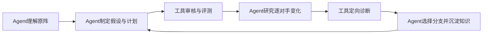

# gekitotsu_lab

激突Lab **0.6.5**，内置并使用激突Kit **1.9.1**，两者独立维护版本。

**从轻巧的工具箱，走向大模型实验室。**

激突Lab承袭激突Kit的工具箱基础，为大模型Agent提供研究阵型、检验战术假设的实验环境，积累可核验的结果与可复用的知识。

**让Agent读懂阵型、设计并执行对照实验，从真实对局中学习，再交付有证据的改阵。**

本项目将激突Kit、Agent工作约定、造阵知识、可执行工具和实验状态整合在同一工作区。能读写本地文件、运行命令的Agent，依据规则与机制研究原阵，提出可检验的修改，组织评测，并根据具体对手的收益与退步决定下一步。

[English](README.md) | 简体中文 | [日本語](README.ja.md)

## Agent具备哪些能力

| 能力 | Agent怎样完成 |
|---|---|
| 理解阵型 | 按实际ID与槽位解码，查阅相关单位和战术知识，梳理火力、支撑、防护/消弹、回复、加速与突击时序 |
| 研究原阵 | 完成或核验复用原阵200/2000/10433基线，分析对手分群及代表胜败局，先解释获胜手段和失败路径，再生成搜索候选 |
| 设计对照实验 | 把观察变成假设、明确父阵、受约束JSON计划、目标对手和失败判据；区分单项与联合变化，保留合法反事实 |
| 执行与管理研究 | 生成候选、执行规则/重力门禁、组织有真实超时的后台评测、复用已核验对局，记录实际计算量与可续跑进度 |
| 从具体战果学习 | 对照真实父阵的逐对手收益与退步，用少量详细重放检验关键解释，保留不同分支、持平方案和反例，再决定搜索方向 |
| 选阵与交付 | 使用训练和竞争验证反馈选择父阵与决赛名单，分别报告完整阵池成绩及取舍，交付精确阵码、合法性与可核验证据 |
| 续跑与沉淀知识 | 从STATE和冻结输入恢复研究，尊重停止状态与用户选择，持续维护LEARNING；实验结果仅在本地归档，提炼可公开的通用知识 |

这些能力由[AGENTS.md](AGENTS.md)、[研究流程](docs/ai/formation-tuning.md)和[知识库](docs/ai/knowledge/README.md)共同约定。Agent负责推理和决策，下面的工具让它的操作可执行、结果可测量、结论可复核。

## 支撑Agent的工具

| 工具组 | 提供的支持 |
|---|---|
| 生成与重力审核 | 参数化坐标/角度/结构计划、规则检查、稳定态转换、去重与源阵映射 |
| 批评测与核验 | 固定侧位、缺局分批、已核验缓存复用、STOP与逐对手结果复核 |
| 基础/详细观察 | 生命周期、回复、起跳落点、攻击、HP写点、消弹与子弹/爆炸来源链 |
| 存证与有界查询 | 完整JSON、SQLite索引、哈希、字段投影、单位/时间筛选与分页 |
| Kit共享分析 | 通过CLI/JSON访问图鉴、工作台、轨迹、贡献、画像和战场分析，与GUI共享相关模型 |

对战GUI、阵型工作台、轨迹编辑、单位图鉴和效果插件继续可用，操作见[使用手册](使用手册.md)。

## 快速开始

### 让Agent开始工作

在支持本地文件和命令执行的Agent环境中打开当前目录，先让Agent读取[AGENTS.md](AGENTS.md)和[文档入口](docs/ai/README.md)，再提供原阵、约束、目标和计算预算。可复用任务见[PROMPTS](docs/ai/PROMPTS.md)。

```text
先读AGENTS.md和docs/ai/README.md。
原阵：<路径>。规则与允许改动：<约束>。
目标与侧位：<目标>。模拟预算：<上限>。
按当前研究流程执行，复用已核验证据，保存STATE与下一步依据。
```

### 玩家参与，让改阵更有效

建议玩家持续参与改阵：监督研究方向，提出战术思路，并和Agent讨论每轮发现。玩家的实战经验与Agent的批量实验可以互相补充，帮助发现遗漏的方向、纠正误解，让改阵更贴合自己的目标。

- **明确想保留什么。** 说明阵型特色、必留单位、允许改动的范围，以及更在意哪些对手和取舍。
- **把经验变成可检验的思路。** 提出你观察到的弱点或配合，让Agent先解释机制、设计小规模对照，再决定是否扩大搜索。
- **监督过程与证据。** 阶段性查看代表胜败局和逐对手得失，追问改善来自哪里、又牺牲了什么；发现解释与实战不符时及时反馈。
- **根据结果继续交流。** 一轮结束后讨论保留、放弃或尝试的新方向，必要时调整预算或停止。战术建议先作为假设，用实际对局验证。

例如：“我怀疑前排过早倒下让后排断火。先保留核心和主攻单位，对照测试支撑位置与防护配置，报告救回了哪些败局、又新增了哪些败局，再一起决定下一步。”

### 准备工具

当前维护的执行流程使用Windows与PowerShell。准备JDK 21+、Maven 3.9+、支持Rust 2024 edition的工具链及MSVC链接工具，以及名为`opencode`的conda环境。Python命令工具只依赖标准库。

在项目根目录执行：

```powershell
conda activate opencode
$env:PYTHONIOENCODING = 'utf-8'
./tools/ai/build.ps1
python tools/ai/gravity.py build --timeout 300
```

`build.ps1`构建研究版JAR及基础/详细观察器，重力审核器使用独立构建与输出目录。依赖下载按[环境与网络说明](docs/ai/03-tool-runbook.md#环境准备)配置；Cargo下载可通过HTTP_PROXY/HTTPS_PROXY显式配置代理。依赖已缓存时可用`build.ps1 -Offline`。

先查看接口能力、检查后端并解析示例阵，这些命令不运行对战：

```powershell
conda activate opencode
python tools/ai/ai.py --timeout 30 capabilities
python tools/ai/ai.py --timeout 30 probe
python tools/ai/ai.py --timeout 30 formation --file docs/ai/examples/candidate.txt
```

从源码构建后启动GUI：

```powershell
java -jar target/gekitotsu_lab-0.6.5.jar
```

CLI/JSON调用见[工具手册](docs/ai/03-tool-runbook.md)与[能力地图](docs/ai/capabilities.md)。在本地发行包中也可使用`gekitotsu_lab.exe`；打包程序与源码构建各自保留版本身份。

## 怎样用它造阵



先读懂原阵，完成或核验复用原阵完整基线；随后以有对照的小批候选迭代。每批研究具体对手的收益和退步，对有明确问题的变化局补少量诊断，再选择下一父阵与参数方向。

当前阵池分工是：**标准200用于训练与筛选，验证2000用于竞争验证，完整10433用于冻结决赛名单后的决胜**。帧上限未决计平局，缺局与进程失败单列为失败。阵池身份、选拔和评分规则统一见[阵集政策](docs/ai/10-benchmark-usage.md)。

实际执行链为`formation_workflow generate/accept` → `gravity.py evaluate` → `verify_pool.py`。完整步骤见[研究流程](docs/ai/formation-tuning.md)，计划格式见[生成器](docs/ai/generator.md)，静态模型和侧位范围见[重力审核](docs/ai/gravity-audit.md)。

## 查什么知识

[文档入口](docs/ai/README.md)按问题导航。[基础机制](docs/ai/08-formation-fundamentals.md)和[单位百科](docs/ai/knowledge/units/README.md)解释支撑、计数、更新顺序、单位行为和生成物；[战术知识库](docs/ai/knowledge/tactics/README.md)用于理解获胜路径与体系配合，[弹幕时序](docs/ai/13-volley-timing.md)用于区分发射相位和实际命中。

[分析使用](docs/ai/knowledge/analysis-usage.md)说明热图、删除贡献和伤害来源能证明什么，[搜索经验](docs/ai/11-search-lessons.md)帮助设计条件对照、检查持平平台与边界。[数据契约](docs/ai/data-contract.md)与[详细模式](docs/ai/detailed-mode.md)定义字段、事件和查询含义；[实验契约](docs/ai/05-experiment-contract.md)规定证据与交接记录。

## 代码结构

| 路径 | 用途 |
|---|---|
| [AGENTS.md](AGENTS.md) | Agent工作约定、阅读路径、任务约束与交接规则 |
| `src/main/java/` | Kit GUI、共享分析模型、Java --ai入口 |
| `tools/ai/` | 候选生成、重力、评测、观察、查询与核验工具 |
| `rust/observer/` | 独立gkt-observe与gkt-detail观察程序 |
| `rust/gravity/` | 独立构建的静态重力与支撑审核器 |
| `rust/vendor/` | 固定版本的核心源码、来源与哈希清单 |
| `benchmarks/` | 冻结对手池与身份清单 |
| `docs/ai/` | 流程、契约、机制、战术与研究方法 |
| `experiments/` | 运行时创建的本地实验目录，Git忽略，不随仓库分发 |

## 引擎版本与证据

快速评测使用所选JAR内置的JNI DLL，源码观察器使用固定来源的派生Rust核心。当前源码规则`catalog-hp-v1`将蓝加速器HP设为100、电梯壁设为75；原发行包DLL仍保留原规则，重新构建源码不会替换该DLL。跨后端比较或重放前，先核对[HP版本](docs/ai/unit-hp-rules.md)和[引擎适用范围](docs/ai/01-project-map.md#引擎核验与证据范围)。

阵码、物理侧位、帧上限、seed政策及引擎/适配器哈希共同构成证据身份。诊断结果与对应评测一致后，才用于解释该对局；静态审核仅证明其声明模型和侧位，模拟器结果也不直接等同原Flash表现。

## 作者与协议

基于[gekitotsu_java](https://github.com/xx786029704-arch/gekitotsu_java)，核心源码来源于[gekitotsu_rust](https://github.com/xx786029704-arch/gekitotsu_rust)。

作者：**XX、DeepSeek、15222HGH、MKTL、GPT-6.1 Sol、Nightvision65**。

本项目为非官方粉丝作品，游戏素材归原作者；项目代码使用[MIT协议](LICENSE)。

[Release build and package contents](docs/releasing.md) · [Third-party notices](THIRD_PARTY_NOTICES.md)
